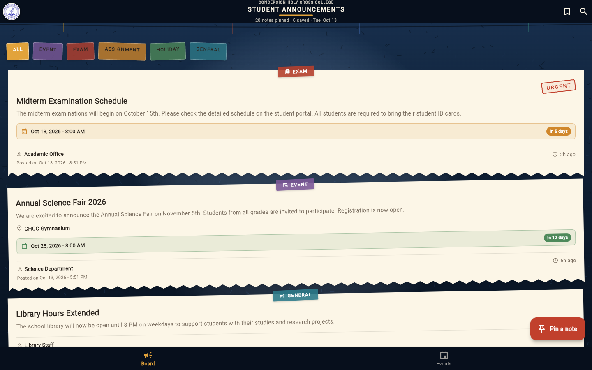
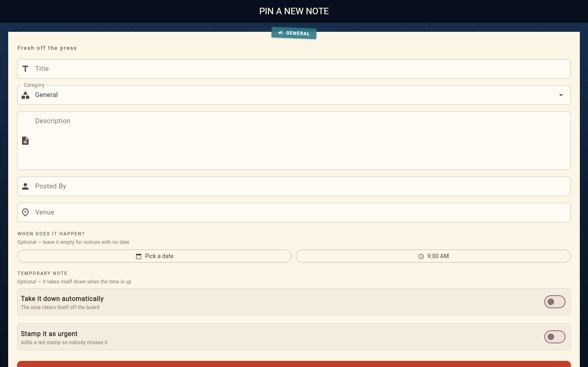
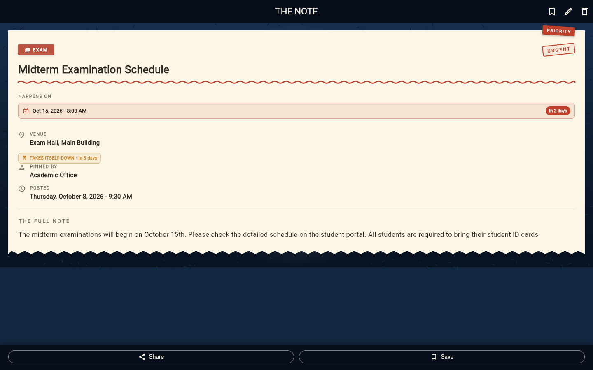
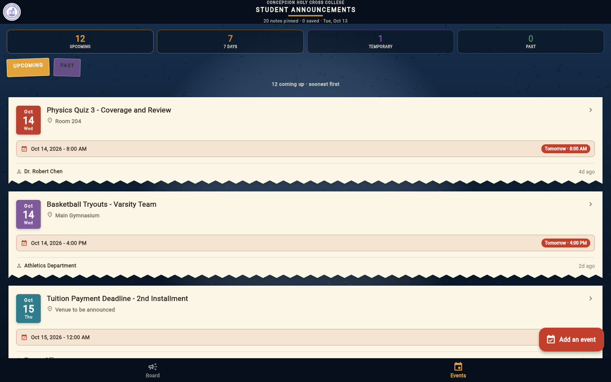
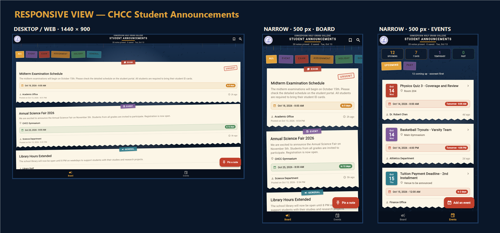

# CHCC Student Announcements — Short Documentation

---

## 1. Project Title

**CHCC Student Announcements: A Campus Bulletin Board and Events Application**

| | |
| --- | --- |
| **Framework** | Flutter (Dart), Material Design 3 |
| **App id / version** | `com.example.student_announcements` — 1.0.1+2 |
| **Platforms** | Android, Web, Windows, macOS, Linux, iOS (one codebase) |
| **Storage** | Local only (`shared_preferences` as JSON) — works fully offline |
| **Sem & School Year** | 1st Sem, SY 2026–2027 |

---

## 2. Description

CHCC Student Announcements is a Flutter application that acts as the digital
campus bulletin board of Concepcion Holy Cross College, Inc. Instead of paper
notices pinned to a cork board in the hallway, students and offices pin digital
notes about events, exams, assignments and holidays, and read them anywhere
from their phones.

The look of the app is inspired by the real campus notice board at night:
cream paper notes are pinned to a deep navy board, taped down with coloured
washi tape, tilted at tiny hand-pinned angles, and stamped red when they are
urgent. The official seal of Concepcion Holy Cross College, Inc. sits in the
header beside the wordmark.

Beyond the bulletin board, the app now carries a **campus events diary**: every
dated note is collected on its own tab, sorted soonest-first, showing the date,
the **venue**, a live countdown, and — for temporary notices — the moment the
note will take itself down.

---

## 3. Features of the Application

### 3.1 Main screens

| Screen | What it does |
| --- | --- |
| **Board** (home) | CHCC crest and wordmark in the app bar, bunting strung underneath, filter tabs cut from tape, and a feed of paper notes that drop onto the board one after another. |
| **Events / Summary** | The campus diary: an at-a-glance summary strip (Upcoming, Next 7 Days, Temporary, Past), an **Upcoming / Past** switch, and every dated note sorted soonest-first with a calendar chip, venue and countdown. |
| **The note** (detail) | The full sheet on the navy board with a hand-drawn underline, venue and schedule rows, pin metadata, and a bottom bar for sharing or saving. |
| **Pin a new note** (create) | A fresh sheet with category tape, validation, urgency stamp, **venue field**, date + time pickers, and the **take-it-down timer** for temporary notes. |

Navigation between the Board and the Events page is a **bottom navigation
bar**; the floating button matches the tab — *Pin a note* on the board,
*Add an event* on the diary.

### 3.2 Core functions

- **Create** — the "Pin a note" button opens the form; title, details and who
  posted it are required, while category, venue, urgent stamp, event date/time
  and expiry are optional.
- **Edit** — the pencil icon on the sheet reopens the form pre-filled; "Save
  changes" keeps the original posted date and id.
- **Delete** — swiping a note left (or the trash icon on the sheet) asks for
  confirmation first, then shows **UNDO** in the snack bar.
- **Search** — the magnifier drops down a search box that matches title,
  details *and* who posted the note, on top of the category tabs.
- **Saved notes** — the bookmark files a note into the student's pocket; the
  bookmark in the app bar filters the board to saved notes only.
- **Categories** — General, Event, Exam, Assignment and Holiday, each with its
  own colour and icon; the tape tabs filter the board by category.
- **Persistence** — the whole board is stored as JSON in `shared_preferences`,
  so notes added, edited, saved or deleted today are still there tomorrow.

### 3.3 Events, venues and temporary notes

- **Events page** — a second tab that lists every note with a date, **soonest
  first**, with an **Upcoming / Past** switch and an empty state.
- **Summary strip** — four counters at the top of the page: **Upcoming**,
  **7 Days**, **Temporary** and **Past**.
- **Venue** — a field of its own (no longer buried in the description). It
  appears under the title on the board, on every event card, and as a **VENUE**
  row on the note sheet; an empty venue reads *"Venue to be announced"*.
- **Countdown** — every dated note shows its exact date and time plus a pill
  (`Today`, `Tomorrow`, `In 5 days`, `3 days ago`): red within 2 days, amber
  within a week, green after that.
- **Temporary notes** — a switch on the form ("Take it down automatically")
  with the choices *After the event*, *In 24 hours*, *In 3 days*, *In 7 days*
  and *In 30 days*, plus a live preview of the exact moment. Temporary notes
  carry an amber **TAKES ITSELF DOWN** pill, and once the time passes they are
  removed from the board, from the events page and from storage — no clutter.
- **Web deep links** — `?screen=board`, `?screen=events`, `?screen=detail`
  and `?screen=compose` open that screen directly, which is handy for sharing
  a link and for taking screenshots.

### 3.4 Testing and quality assurance

`flutter test` runs **12 widget (smoke) tests** — rendering, filtering,
search, compose, detail, delete-with-undo, saved notes, editing, the events
tab with venues, soonest-first ordering, expiry of temporary notes, and
pinning a temporary note with a venue — plus **4 golden snapshots**
(`board`, `detail`, `compose`, `events`). Regenerate the snapshots after a
design change with `flutter test --update-goldens`. `flutter analyze` reports
no issues.

---

## 4. Screenshots

### 4.1 Home screen



*Figure 1. Home screen (Board tab): category tape tabs, urgent stamp, venue
under the title, date strip with countdown pill, and the Board / Events
bottom navigation.*

### 4.2 Form and details screens

| Form (create / edit) | Details (the note) |
| --- | --- |
|  |  |

*Figure 2. The "Pin a new note" form with the Venue field, date + time
pickers, and the Temporary note switch (left); the note sheet with its
HAPPENS ON schedule, urgent stamps, metadata and the share/save bar (right).*

### 4.3 Summary / result screen



*Figure 3. Events tab — the summary strip (Upcoming, 7 Days, Temporary,
Past), the Upcoming / Past switch, and the diary sorted soonest-first with
calendar chips, venues, countdowns and a "TAKES ITSELF DOWN" pill.*

### 4.4 Responsive view



*Figure 4. The same app at two widths — **1440 × 900** on the web / desktop
(left) and a **500 px** narrow window (centre: board, right: events). The
board reflows to a single column, the tape tabs scroll horizontally, the
summary strip stays on one row, and the bottom navigation stays reachable.*

The layout uses Flutter's responsive primitives (constraints, `Expanded`,
`ListView`, `Wrap`), so one codebase serves phones, tablets, browsers and
desktops. Standalone captures of the narrow layout are also in
`screenshots/responsive_home_narrow.png` (board) and
`screenshots/responsive_mobile.png` (events).

---

## 5. Member Roles

This is a **group project** with two members:

| Member | Role |
| --- | --- |
| **Princess Panganiban** | Project lead · UI/visual design (corkboard theme, screens, layout) · documentation and screenshots |
| **Angelo Sese** | Application logic and data model (Announcement, JSON storage) · events, venue and temporary-note features · automated testing and build/deployment |

*(Adjust the split above to match the work you actually divided.)*

---

## 6. How to Run

```bash
flutter pub get      # download dependencies
flutter run          # run on any device, emulator or browser
flutter test         # 12 widget tests + 4 golden snapshots
flutter build apk --release   # Android installer
```
